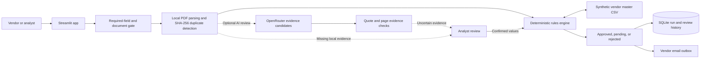

# PayeeTrail

**Vendor onboarding review with explainable, rules-based checks.**

[](https://github.com/Karna2006/PayeeTrial/actions/workflows/tests.yml)

PayeeTrail is a Streamlit prototype that helps a procurement team review vendor submissions. It compares form entries with uploaded GST, PAN, and bank documents, highlights inconsistencies, and produces a review outcome with supporting findings and a vendor email draft.

**Live app:** [Open PayeeTrail](https://payeetrial-zamp-ai.streamlit.app/) | **Demo video:** [Watch the PayeeTrail walkthrough on Loom](https://www.loom.com/share/03371742510842048ef6eadd6adda456)

> This is an assignment prototype that uses synthetic data. It is not a production vendor portal or an external verification service.

## Product highlights

- **Required submission gate:** verification stays disabled until all required form fields and document slots are complete. Optional fields can be left blank.
- **27 core checks across five stages:** intake and completeness; identity; bank details; document cross-check; duplicate and fraud screening.
- **Cross-field checks:** validates PAN and GSTIN formats and relationships, GST state against the registered address, and submitted bank details against the uploaded cheque.
- **Content-based document handling:** classifies PDFs by their contents, checks required evidence, flags duplicate files by SHA-256, and blocks conflicting different-content files of the same required type.
- **Bounded PDF intake:** limits file size, page count, extracted text, and the number of documents per submission.
- **Vendor duplicate screening:** checks exact PDF content hashes and sends sufficiently similar vendor names to human review instead of automatically rejecting them.
- **Resubmission monitoring:** compares versions and flags unrequested changes to sensitive bank details for compliance review.
- **Decision traceability:** displays check results by stage, supporting evidence, the decision queue, and the rule signal score. The score is a weighted rule summary, not a fraud probability.
- **Reviewer workflow:** analysts can confirm or correct uncertain document values against the original PDF. Accepted values are checked again, with the review recorded in the audit history.
- **Dashboard and run history:** summarizes outcomes and pending work; run details show documents, checks, submissions, and version history.
- **Vendor email outbox:** creates deterministic email drafts for review. Messages are not sent automatically.
- **Optional AI assistance:** OpenRouter can suggest document classifications, extracted values, cited page evidence, a document evidence-quality score, and optional email wording. AI is advisory and never decides approval.

## How it works



Selectable-text citations are checked against the cited PDF page and candidate values. Visual-only scan values cannot be independently grounded, so they require analyst confirmation. Deterministic rules remain the source of the final outcome.

## Demo scenarios

The repository includes six synthetic cases. Run case 02 before case 05; case 05 is its resubmission.

| Case | Scenario | Expected outcome |
|---|---|---|
| 01 | Consistent form, documents, and bank details | Approved |
| 02 | PAN typo and GSTIN registered in a different state | Pending - awaiting vendor |
| 03 | Third-party bank account also present in the vendor master | Rejected |
| 04 | Sister-company GST certificate and conflicting PAN documents | Pending - awaiting vendor |
| 05 | Resubmission fixes prior issues but changes bank details without being asked | Pending - compliance review |
| 06 | Proprietorship with the owner's personal bank account | Approved |

## Technology

| Area | Implementation |
|---|---|
| Application and UI | Python, Streamlit |
| Local document extraction | pypdf and deterministic text rules |
| Rules and data processing | Python, pandas, rapidfuzz |
| Audit store | SQLite |
| Optional AI provider | NVIDIA Nemotron 3.5 Super VL through OpenRouter |
| Test suite | pytest; synthetic documents and mocked AI responses |
| Hosting | Streamlit Community Cloud |

The core workflow runs without an API key. AI review and email polishing are opt-in.

## Run locally

### Requirements

- Python 3.11 or 3.12
- Git

### Setup

From the repository root:

**Windows PowerShell**

```powershell
py -3.11 -m venv .venv
.\.venv\Scripts\Activate.ps1
python -m pip install --upgrade pip
python -m pip install -r requirements.txt
python scripts/make_samples.py
python -m streamlit run app.py
```

**macOS / Linux**

```bash
python3 -m venv .venv
source .venv/bin/activate
python -m pip install --upgrade pip
python -m pip install -r requirements.txt
python scripts/make_samples.py
python -m streamlit run app.py
```

Open the local URL printed by Streamlit (normally http://localhost:8501). On **Submit & Verify**, load a demo case or enter a submission, attach the required PDFs, and run verification. The generator creates the synthetic scenario documents and vendor master used by the app.

## Optional OpenRouter features

Both AI options are disabled unless an OpenRouter key is configured. Add the key to Streamlit secrets or an environment variable; do not commit secrets.

For local use, create `.streamlit/secrets.toml`:

```toml
OPENROUTER_API_KEY = "your-key"
# Optional; defaults to nvidia/nemotron-3.5-super-vl:free
OPENROUTER_MODEL = "nvidia/nemotron-3.5-super-vl:free"
```

Then enable **Review documents with free AI** or **Polish email with the same model** in the app's Settings. Document review sends selected PDFs to OpenRouter. Email polishing sends the generated email body, which can include names, references, and correction requests. The free endpoint may be rate-limited and may log prompts or use them to improve provider products. Use synthetic demo data only; never send real vendor documents or personal or financial identifiers.

## Run tests

The suite uses synthetic fixtures and mocked provider responses; tests do not require an OpenRouter key or real vendor documents.

```bash
python scripts/make_samples.py
python scripts/make_scan_sample.py
python -m pytest -q
```

GitHub Actions runs the suite on pushes, pull requests, and manual dispatch with Python 3.11 and 3.12.
If pytest cannot create its temporary directory in your Windows environment, run:

```powershell
python -m pytest -q -p no:cacheprovider --basetemp .pytest-tmp\readme
```

## Deploy to Streamlit Community Cloud

1. Push the repository to GitHub.
2. In Streamlit Community Cloud, create an app from this repository, select the `main` branch, and set `app.py` as the entry point.
3. Add `OPENROUTER_API_KEY` in the app's Streamlit secrets only if you want to enable the optional AI features.
4. Deploy. Future commits pushed to the connected branch update the app.

The deployed app URL is provided by Streamlit Community Cloud and ends in `.streamlit.app`.

## Limitations and safe use

PayeeTrail compares submissions with uploaded documents and a bundled synthetic vendor master. It does **not** query GST, PAN, banking, or other external registries, and it does not verify account ownership through a bank. Its outcomes are configured workflow decisions, not proof of a vendor's identity or legitimacy.

This prototype has no user authentication or role-based access control. Runs are stored in a local SQLite database; storage on Streamlit Community Cloud is not a durable production data store. Email drafts are displayed in the outbox and are not sent. Use synthetic data only.

## Project structure

```text
app.py                  Streamlit entry point and navigation
engine/                 Document parsing, validators, rules, decisions, and persistence
services/                Optional OpenRouter integrations
ui/                      Streamlit pages and components
samples/                 Synthetic scenarios and PDFs
data/vendor_master.csv   Synthetic vendor master used by demo checks
tests/                   Rules, scenarios, UI, AI-boundary, and audit tests
docs/                    Product, rules, architecture, demo, and readiness notes
```

## Further reading

- [Product requirements](docs/01_PRD.md)
- [Technology stack and deployment](docs/02_TECH_STACK.md)
- [Rules specification](docs/05_RULES_SPEC.md)
- [Scenario details](docs/06_TEST_SCENARIOS.md)
- [Demo script and interview preparation](docs/10_DEMO_SCRIPT.md)
- [Production readiness and scale plan](docs/11_PRODUCTION_READINESS.md)
- [Testing pipeline](docs/13_TESTING_PIPELINE.md)
