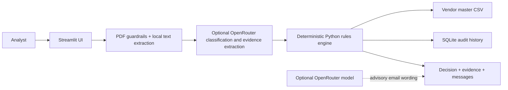
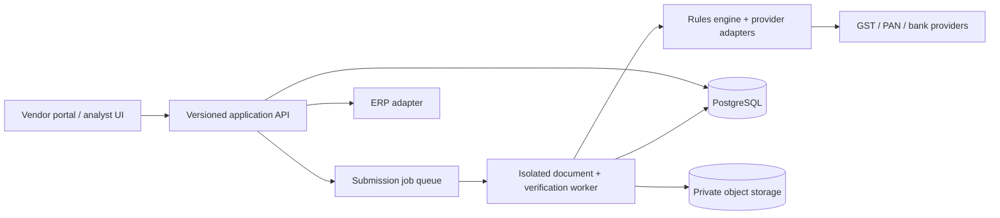

# 11 · Production Readiness and Scale Plan

This is the architecture path from the assignment demo to a controlled vendor-onboarding service. The current Streamlit app is **not production-ready** for real vendor data: it has no login or tenant boundary, uses a local SQLite file, processes PDFs in the web process, and has no external source-of-truth verification.

## Current decision boundary

The rules engine owns all verification outcomes. OpenRouter may classify, extract, and score document evidence, but it does not decide vendor risk. Selectable-text values used by checks are grounded against local PDF text. Visual-only extraction and classifier disagreements enter Compliance review. AI document review and the same model's email rewrite are opt-in. The free endpoint's published terms allow logging and product improvement, so this prototype must only send synthetic demo files and data.

Document review sends selected PDF contents to OpenRouter. Email polishing sends the generated email body, which can include vendor or contact names, submission references, and requested corrections. The application does not send the email address as part of that prompt, and it never sends email automatically.

## Risks and controls

| Risk | Current control and remaining production work |
|---|---|
| Prompt injection in uploaded documents or vendor fields | The extraction prompt treats PDF content as hostile input; the model has no tools or action permissions, receives no API key or form fields in its prompt, and must return a constrained JSON schema. The email model sees generated email text only; its rewrite is a clearly labeled draft and never replaces the deterministic message of record. Model text is displayed as text/table data, never executed as HTML. Keep PDFs out of decision prompts. Add independent red-team cases before production. |
| OCR or model hallucination | Verify each selectable-text quote against the cited page and require the candidate value to appear in its quote. Cap the completeness score using evidenced required fields. Upload autofill only fills blank fields, requires cited evidence for AI candidates, displays the source, and never overwrites conflicts. Scanned documents remain in review until an analyst checks the original PDF. Analyst corrections are separately appended with actor name, time, reason, original values, accepted values, and rerun decision. Production still needs authenticated reviewer identity, role checks, and immutable storage controls. |
| Malformed, encrypted, oversized, or hostile PDFs | Intake limits each file to 10 MB, 40 pages, 300,000 extracted characters, and six files per submission; reports explicit warnings. Before production, add malware scanning and parse in a resource-limited worker with CPU, memory, and wall-clock limits. |
| Model/API abuse or cost spikes | OpenRouter is opt-in, calls only selected bounded PDFs, applies a request timeout and output cap, validates response types/ranges, and never retries automatically. Its free endpoint is rate-limited. Production needs per-tenant quotas, rate limits, spend alerts, and a provider circuit breaker. |
| Incorrect automated approval | Keep decisions deterministic and version the rule set. Any unavailable verification provider, unreadable required evidence, or unresolved conflict must fail closed to a review queue. Never auto-create a payable vendor record from an uncertain result. |
| Fraudulent bank change | Keep the current version-to-version change detection. Require out-of-band verification using a previously registered contact before approving sensitive account changes; log reviewer identity, reason, and evidence. |
| Duplicate submissions and retries | Add idempotency keys, unique `(tenant, submission_ref, version)` constraints, and transactional version creation. Retrying a request must not create multiple vendor records or versions. |
| Reused or renamed documents | Exact uploaded-byte duplicates are compared using SHA-256 across filenames and flagged for analyst attention. Production should also consider malware scanning and perceptual/document-content similarity for re-rendered copies; exact hashes cannot detect content-equivalent PDFs with changed metadata. |
| Similar legal names | Distinctive names with ≥90% similarity to the current vendor master are routed to human review only. The match is not treated as identity proof or an automatic rejection. Production should combine authorized identifiers and organization-specific master-data governance. |
| Sensitive data exposure | This prototype uses synthetic records; the OpenRouter key stays in environment/app secrets and is sent in an HTTP header, never in the prompt or URL. The free endpoint is not suitable for real PAN/account data. Production needs a privacy-approved provider or self-hosted model, auth, tenant access checks, PAN/account masking, encryption at rest, retention/deletion rules, and private storage. |
| Provider outage or stale data | Record provider, check type, response timestamp, request ID, and result freshness. Use bounded timeouts, safe retries, circuit breakers, and an explicit unavailable status; do not translate a timeout into a pass. |

## Verification APIs: when and how

The core local workflow needs no external API. Optional AI review sends the uploaded PDF to OpenRouter only when enabled. Current checks are format, checksum, document cross-check, and comparison with the bundled vendor master; these do **not** prove that a GST registration is currently active or that a bank confirms the account holder. Use synthetic documents in the demo and keep the API key in app secrets.

For a real deployment, add narrow provider adapters behind the existing checks:

1. **GST registration status:** use a supported GST Suvidha Provider (GSP) or approved integration route. GSTN describes access through the GSP ecosystem and legal/technical onboarding; do not build against an assumed public, unauthenticated GST endpoint.
2. **PAN status/name match:** use an authorized PAN-verification service only after the company is eligible and has completed that provider's registration, certificate, security, and commercial requirements.
3. **Bank account ownership:** integrate a contracted bank-verification provider only with an approved consent and data-use flow. An IFSC lookup alone verifies neither ownership nor account activity.
4. **ERP/vendor master:** add read/write adapters only after authorization, duplicate handling, and audit ownership are agreed with the company.

Each adapter should return a typed result such as `verified`, `mismatch`, `unavailable`, or `needs_review`, together with source, timestamp, reference ID, and a safe evidence summary. Keep provider credentials in a secret manager. Cache only when provider terms and freshness requirements allow it. A provider timeout or malformed response is **unavailable**, never `verified`.

## Scale path

Start with a **modular monolith**, not microservices:

Recommended sequence:

1. Keep the rules package framework-independent; expose it through a versioned backend API when a second client or concurrent users need a stable interface.
2. Move the audit store from SQLite to PostgreSQL and enforce tenant, idempotency, and version constraints in the database.
3. Store original PDFs in private object storage, not database rows or a web-server disk. Persist an object key, checksum, MIME/PDF validation result, and retention deadline in the audit record.
4. Move OCR, PDF parsing, and live provider checks to a queue-backed worker. The UI should show `received`, `processing`, `needs_review`, `complete`, or `failed` with a retryable job ID.
5. Add authentication, role permissions, tenant isolation, audit access logging, encrypted backups, alerting, and recovery procedures before onboarding real companies.

Streamlit can remain an analyst-facing prototype or internal tool; it should not be treated as the API, identity layer, durable file store, and worker system all at once. Streamlit Community Cloud also does not guarantee persistence for files written to the app's local filesystem.

## Next implementation stages

| Stage | Deliverable | Exit check |
|---|---|---|
| A · Intake reliability | Optional OpenRouter PDF review, explicit visual-only status, file/page limits and reviewer warnings | Text and scanned PDFs receive classification/extraction; scan-only values and uncertain results cannot auto-approve |
| B · Rule governance | Rule-set version on every run; reviewer override with actor, reason, and original decision retained | Replaying the same input with the same rule version yields the same decision |
| C · API contracts | Provider adapter protocols and mock providers; unavailable/mismatch/verified states | Engine tests cover timeout, malformed response, mismatch, duplicate retry, and stale response |
| D · Multi-user pilot | Backend API, PostgreSQL, object storage, queue worker, authentication and tenant isolation | Two tenants cannot read or mutate each other's submissions; workers recover safely after restart |
| E · Controlled production | Provider agreements, privacy/retention review, security testing, monitoring, incident and recovery runbooks | Security and business owners sign off before real vendor PII is processed |

The first real-company rollout should be a limited pilot with human approval required for every vendor. Production readiness is a set of controls and operational evidence, not a UI polish milestone.
